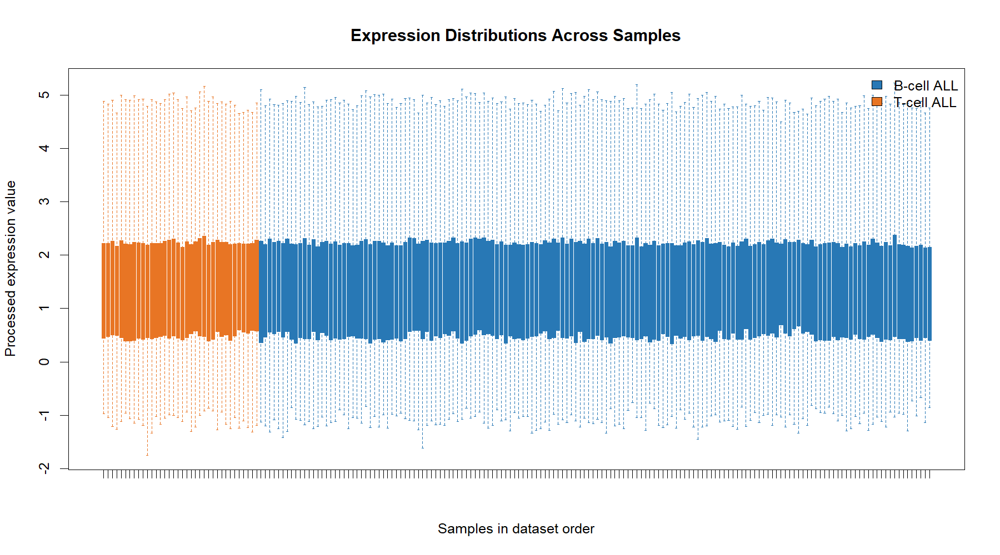
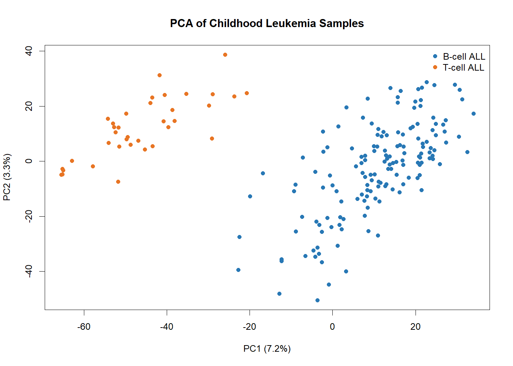
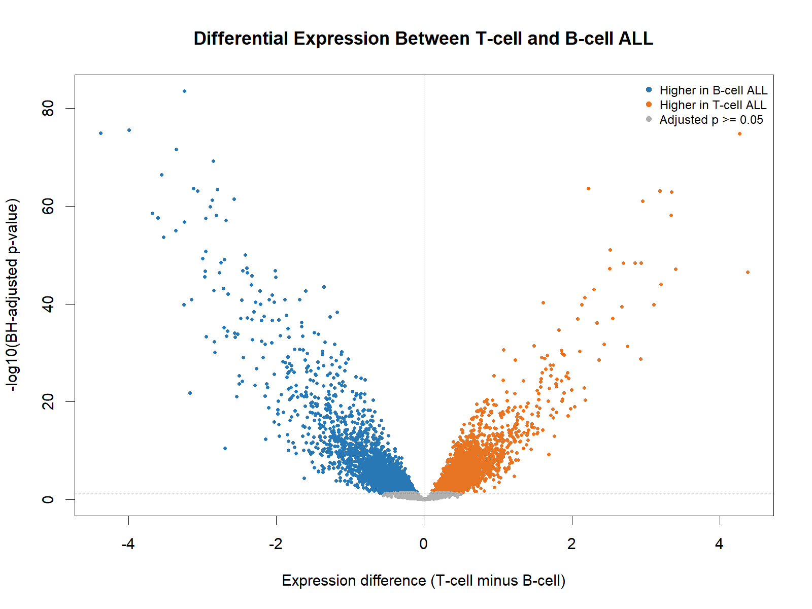
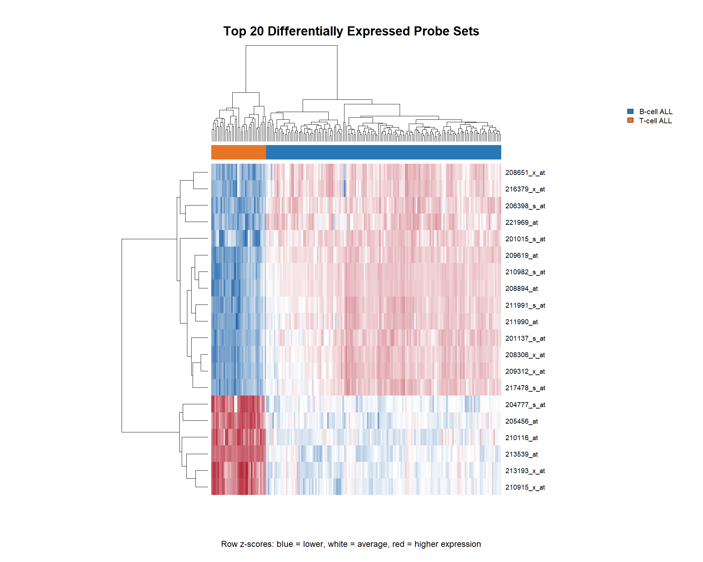

# Comparing Gene Expression in Childhood B-Cell and T-Cell Leukemia

## Abstract

This project investigates expression differences between precursor B-cell and T-cell acute lymphoblastic leukemia (ALL) using the public GSE13425 childhood ALL dataset. The processed matrix contained 22,277 probe sets across 190 samples, comprising 154 B-cell ALL and 36 T-cell ALL samples. Sample labels, matrix alignment and missing values were checked in R. Exploratory analysis included sample boxplots and principal component analysis (PCA). Differential expression was evaluated with limma and Benjamini–Hochberg adjustment. In total, 6,711 probe sets met an adjusted p-value threshold of 0.05. Of these, 3,607 had higher expression in T-cell ALL and 3,104 had higher expression in B-cell ALL. PCA and a heatmap of selected probe sets showed differences between the recorded groups. These exploratory findings describe this cohort and require independent validation before clinical interpretation.

## Introduction

The practical problem addressed by this project is identifying molecular differences between two recorded childhood leukemia groups. A gene expression dataset contains measurements for thousands of features in each sample. Interpreting those measurements individually is difficult, so a computational workflow is needed to organise the samples, compare groups and summarise the evidence. The aim here is to produce an understandable and reproducible comparison using public biomedical data.

The research question is whether precursor B-cell ALL and T-cell ALL samples show different expression patterns in GSE13425, and which measured probe sets provide the strongest evidence of a difference. The null hypothesis for each probe set is that its mean processed expression is equal in the two groups. The alternative is that the means differ. The analysis estimates both the direction of the difference and its statistical evidence.

The project focuses on an interpretable group comparison. It uses R for import, checks, visualisation and statistical modelling. All 190 samples are used to estimate differences. There is no train–test split because the analysis does not evaluate a predictive classifier. A further study could investigate prediction with separate training and validation samples.

## Data

The source is NCBI Gene Expression Omnibus accession GSE13425, described as the COALL cohort used to construct a classification signature. It contains expression data from 190 newly diagnosed childhood ALL cases. The platform is Affymetrix Human Genome U133A, GPL96. The accompanying sample records describe bone marrow or peripheral blood material and preprocessing with affy and variance stabilisation using vsn. A set of 22,277 shared probe sets was selected, and the original preprocessing jointly normalised the COALL and DCOG cohorts [1,2].

The project analyses that supplied processed expression matrix. Its rows represent probe sets and its columns represent samples. Probe sets are the measurement units used throughout the results. Mapping several probes to the same gene can change the number of unique genes represented, so gene-level counts would require an additional annotation step.

The sample metadata provided the labels used to define the comparison. Labels beginning with `Precursor-B` followed by `ALL` were assigned to B-cell ALL. The exact label `T-ALL` was assigned to T-cell ALL. The resulting groups contained 154 and 36 samples respectively. A whitespace-tolerant matching rule was required because 44 hyperdiploid precursor B-cell records contained an extra space in their label. Assertions ensured that every sample received a recognised group.

The analysis uses public sample identifiers and measurements. No additional patient contact information was collected. Reusers should cite the dataset and consult the source terms and institutional guidance for their intended use. This repository does not assign a new licence to the source dataset.

## Methods

### Import and quality checks

GEOquery reads the processed series matrix into R [3]. The import script downloads the compressed matrix directly and retains a local copy. This avoids the directory-listing connection failure encountered with the original accession-based request. Subsequent runs reuse the downloaded matrix. The group-checking script saves the expression matrix and metadata together in an RDS file for later scripts.

Checks verified recognised group labels and exact agreement between expression column identifiers and metadata row identifiers. The matrix contained zero missing expression values. The observed minimum was approximately −1.75, the median 1.44 and the maximum 8.35. The values were analysed on the supplied processed scale. No additional logarithmic transformation was applied. No samples were removed during these checks.

### Exploratory analysis

A separate boxplot for each sample summarised its expression distribution, with colours indicating the recorded group. Individual outlier points were hidden to make the 190 distributions readable. The figure was used to inspect broad differences in location and spread, rather than to establish the quality of each individual probe measurement.

PCA was performed after excluding any features with zero variance. Samples were treated as observations and expression features as variables. Features were centred but not scaled to unit variance. The first two components were plotted with group colours. Their explained variance percentages were calculated from the squared component standard deviations.

### Differential expression

A limma linear model estimated separate mean expression values for B-cell and T-cell ALL, followed by the contrast T-cell minus B-cell. Empirical Bayes moderation was applied with `eBayes` [4]. The model contained the group term only. Consequently, its estimated differences are unadjusted for other possible sample characteristics.

Benjamini–Hochberg adjustment was applied across all 22,277 tested probe sets. The selection rule was an adjusted p-value below 0.05, without an additional minimum effect-size threshold. Positive coefficients indicate higher mean processed expression in T-cell ALL, while negative coefficients indicate higher expression in B-cell ALL. Although limma labels the coefficient column `logFC`, the figures describe it as an expression difference on the supplied processed scale. No exact fold-change conversion is claimed.

### Visualisation and outputs

The volcano plot combines the estimated expression difference with the negative base-10 logarithm of the adjusted p-value. Significant features are coloured by direction. The heatmap uses the 20 significant probe sets with the smallest adjusted p-values, breaking ties using raw p-values. Each selected row is standardised across samples, and rows and columns are hierarchically clustered. A sample annotation bar identifies the recorded groups. CSV files retain all tested results and the significant subset, including probe identifiers, coefficients and adjusted p-values.

## Results

| Measure | Observed result |
|---|---:|
| Total samples | 190 |
| B-cell ALL samples | 154 |
| T-cell ALL samples | 36 |
| Probe sets tested | 22,277 |
| Missing expression values | 0 |
| Significant probe sets, adjusted p < 0.05 | 6,711 |
| Significant with higher T-cell expression | 3,607 |
| Significant with higher B-cell expression | 3,104 |

### Expression distributions

The boxplots showed broadly similar central distributions and interquartile ranges across samples. There was no striking overall shift separating the two coloured groups. Individual samples varied in their whisker ranges. This visual inspection supports comparing the processed values while providing only a broad assessment of their distribution.



*Figure 1. Sample expression distributions in dataset order. Blue represents B-cell ALL and orange represents T-cell ALL. Outlier points are omitted from the display.*

### Principal component analysis

PC1 explained 7.15% of the total variation, and PC2 explained 3.31%. Together they represented 10.46%. T-cell samples appeared predominantly on the negative side of PC1, while B-cell samples occupied a different region, with additional spread within the B-cell group. The separation indicates a group-associated expression pattern in this projection. Most total variation remains in components beyond those shown.



*Figure 2. PCA using centred expression features with nonzero variance. Each point represents one sample. Axis labels display rounded explained variance percentages.*

### Differential expression findings

The analysis identified 6,711 significant probe sets, approximately 30.1% of those tested. Of these, 3,607 had positive coefficients and 3,104 had negative coefficients. This distribution shows that the detected differences occurred in both directions. The volcano plot contains features with large estimated differences and very small adjusted p-values, alongside many features near zero with weaker evidence.



*Figure 3. Estimated T-cell minus B-cell expression difference against −log10 adjusted p-value. The horizontal line marks adjusted p = 0.05. Colours indicate the direction of significant differences.*

| Probe set | Estimated T-cell minus B-cell difference | BH-adjusted p-value |
|---|---:|---:|
| 209619_at | −3.241448 | 2.866605 × 10⁻⁸⁴ |
| 210982_s_at | −3.988778 | 2.896121 × 10⁻⁷⁶ |
| 208894_at | −4.375866 | 1.156999 × 10⁻⁷⁵ |
| 213539_at | 4.270326 | 1.292587 × 10⁻⁷⁵ |
| 206398_s_at | −3.349943 | 2.529913 × 10⁻⁷² |

The top-ranked probe set, 209619_at, had higher mean expression in B-cell ALL. Probe set 213539_at showed the opposite direction. These identifiers allow the results to be checked against the exported CSV before any biological annotation is attempted.

### Selected-feature heatmap

The heatmap showed contrasting patterns across the two annotated groups. Some selected probes had relatively higher values in B-cell samples, while others had relatively higher values in T-cell samples. The column dendrogram grouped the two recorded types into distinct regions in this selected-feature display.



*Figure 4. Row-standardised expression for the top 20 significant probe sets. Within a row, blue indicates below-average expression and red indicates above-average expression. The top annotation bar uses separate colours to identify sample groups.*

## Discussion

The results answer the research question by identifying expression differences associated with the two recorded leukemia groups. The PCA provides an exploratory view based on the broader expression matrix, while limma supplies feature-level estimates with adjustment for multiple testing. The heatmap makes the strongest selected differences easier to inspect. Together these outputs provide a traceable description of the cohort.

Several limitations affect interpretation. The sample counts are unequal, and the broad B-cell group combines multiple recorded subtypes. The fitted model contains no adjustment for age, sex, sample source, treatment-related factors or technical batches. Any such influences that coincide with group membership could contribute to estimated differences. No independent cohort was analysed, so generalisation remains untested.

The heatmap is also a selected-feature display. Its probe sets were chosen using the same group labels and samples that it visualises. Clear separation is therefore descriptive evidence within this cohort, rather than an independent estimate of classification performance. A future predictive study would require feature selection within training folds and evaluation on held-out samples.

Statistical significance should be considered alongside effect sizes and biological context. The threshold used here can retain small differences because no minimum coefficient magnitude was imposed. Probe annotation, duplicate-gene handling and functional enrichment would help connect the numerical results to biological mechanisms. Those steps would also support a more focused shortlist for subsequent validation.

## Conclusion and future work

This R workflow compared 154 B-cell and 36 T-cell childhood ALL samples across 22,277 probe sets. It found 6,711 probe sets with BH-adjusted p-values below 0.05 and visualised group-associated patterns through PCA, a volcano plot and a selected-probe heatmap. Future work should annotate probes, assess technical and clinical covariates, and evaluate findings in an independent cohort. The current outputs support exploratory molecular comparison and provide a reproducible starting point for those extensions.

## Reproducibility

Download or clone this repository. In RStudio, set the working directory to the repository root containing this README and the `code` folder. Use an internet connection for the first package installation and matrix download. Run the complete workflow with the following command.

```r
source("run_analysis.R")
```

The runner executes scripts 01 through 05 in order. Script 01 downloads the processed matrix into `data`. Script 02 checks labels and saves `data/leukemia_checked.rds`. Script 03 generates the boxplot and PCA figure. Script 04 writes the limma results. Script 05 produces the volcano plot and heatmap. Required packages include GEOquery and limma, with BiocManager used for installation. Installed versions from the recorded analysis are listed in `results/session_info.txt`, which is refreshed after a complete run. The final script changes should be checked in a fresh R session before submission.

## References

1. NCBI Gene Expression Omnibus. GSE13425, COALL childhood ALL expression dataset. https://www.ncbi.nlm.nih.gov/geo/query/acc.cgi?acc=GSE13425
2. NCBI Gene Expression Omnibus. GSE13425 sample processing documentation, example GSM338714. https://www.ncbi.nlm.nih.gov/geo/query/acc.cgi?acc=GSM338714
3. Davis S, Meltzer PS. GEOquery, a bridge between the Gene Expression Omnibus and BioConductor. Bioinformatics. 2007, 23(14), 1846–1847. https://doi.org/10.1093/bioinformatics/btm254
4. Ritchie ME et al. limma powers differential expression analyses for RNA-sequencing and microarray studies. Nucleic Acids Research. 2015, 43(7), e47. https://doi.org/10.1093/nar/gkv007
5. R Core Team. R, a language and environment for statistical computing. https://www.r-project.org/
